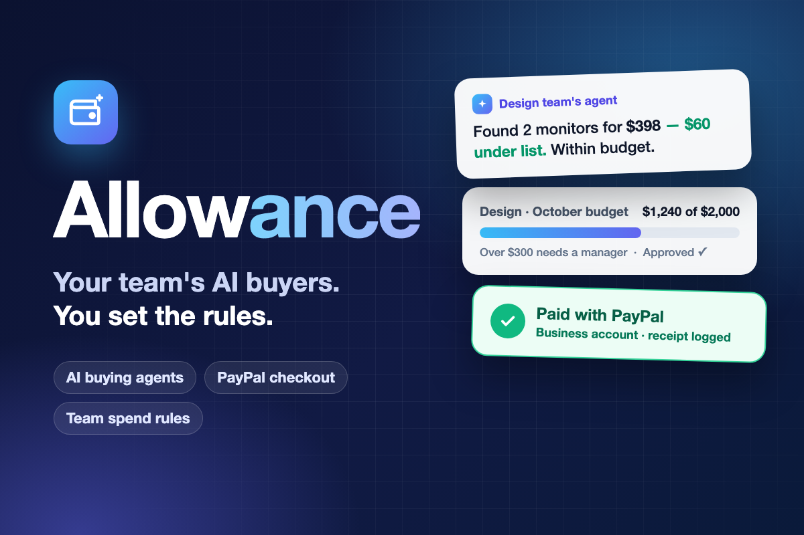
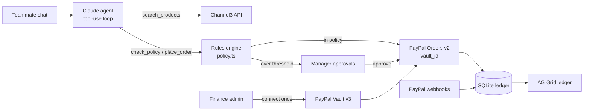

# Allowance

**Give every teammate an AI buying agent. It finds the best deal, pays with your company's PayPal, and never breaks the budgets or approval rules you set.**

Built for the [PayPal AI Hackathon](https://paypalaihackathon.devpost.com/) (2026). Runs entirely on the **PayPal sandbox**: no real money moves.



## The problem

On small teams, buying a monitor or a software seat means waiting for whoever holds the company card, or paying yourself and filing an expense report weeks later. Finance only finds out after the money is gone. AI agents could do the buying, but nobody wants to hand an AI the company card with no rules.

## What Allowance does

| Who | What they do |
|---|---|
| **Teammate** | Asks in plain English: *"I need a 27-inch 4K monitor for design work, under \$600."* The agent searches real stores, recommends one with a reason, checks it against the rules, and buys it after the teammate confirms. |
| **Finance admin** | Connects the company PayPal account once (PayPal Vault), then sets per-team monthly budgets, an approval threshold, per-category caps, and blocked categories. |
| **Manager** | Gets anything over the threshold in an approvals queue. One tap approves and pays, or declines. |
| **Everyone** | Sees a live spend ledger (AG Grid): who bought what, from which budget, with the PayPal order ID. |

### The key design choice

**The AI decides *what* to buy. Code decides *whether* it's allowed.** The model can only pass the ID of a search result it was shown; the price, category and decision come from the server. A purchase of price $p$ for team $t$ is paid automatically only if:

- the category isn't blocked and $p \le$ the category's per-item cap,
- $S_t + p \le B_t$ (spend committed this month plus this item stays within the team budget), and
- $p \le A_t$ (the team's approval threshold).

If only the threshold fails, it goes to the manager. Otherwise it's refused, and the agent explains which rule blocked it. The rules engine is a pure function with unit tests: [`src/lib/policy.ts`](src/lib/policy.ts).

## How it uses PayPal

All calls are in [`src/lib/paypal.ts`](src/lib/paypal.ts), against `api-m.sandbox.paypal.com`.

| PayPal capability | How Allowance uses it |
|---|---|
| **OAuth 2.0 client credentials** | Server-side access token, cached until expiry. |
| **Vault API v3: setup tokens and payment tokens** | The admin approves saving the company PayPal account once. Allowance stores only the resulting payment token, never credentials. This is what lets an agent pay with no human at the keyboard. |
| **Orders API v2** | Each approved purchase creates an order with `payment_source.paypal.vault_id` and captures it. The purchase ID is the `PayPal-Request-Id`, so a retry can never double-charge. |
| **Webhooks + signature verification** | `PAYMENT.CAPTURE.COMPLETED / DENIED / REFUNDED / PENDING` events update the ledger, so it reflects what PayPal actually settled. Events are verified with `/v1/notifications/verify-webhook-signature` and de-duplicated. |

## How it uses AI

| Tool | Use |
|---|---|
| **Claude (Anthropic API, `claude-opus-5-5`)** | The buying agent. It runs a tool-use loop ([`src/lib/agent.ts`](src/lib/agent.ts)) with three tools: `search_products`, `check_policy` and `place_order`. It compares options, explains its pick, tells the teammate upfront whether the purchase will be paid, need approval or be refused, and only orders after explicit confirmation. Tool inputs are schema-validated (`strict: true` + Zod). |
| **Channel3 product search API** | `search_products` calls Channel3 for real, structured product data (title, store, price, availability, buy link) across thousands of retailers, so the agent never invents products or prices. Without a `CHANNEL3_API_KEY`, a small built-in sample catalog is used and the UI labels it as such. |

## Architecture



**Stack:** Next.js 15 (App Router) + TypeScript + Tailwind, Node's built-in SQLite (`node:sqlite`, nothing native to install), `@anthropic-ai/sdk`, AG Grid Community, Zod.

## Run it locally

**Requirements:** Node.js 22.13 or newer.

```bash
git clone https://github.com/blop77/allowance.git
cd allowance
npm install
cp .env.example .env.local   # then fill in the keys below
npm run dev                  # http://localhost:3000
```

### Keys (all free)

1. **PayPal sandbox app:** go to [developer.paypal.com](https://developer.paypal.com/) → Apps & Credentials → **Sandbox** → Create App. Copy the **Client ID** and **Secret** into `PAYPAL_CLIENT_ID` and `PAYPAL_CLIENT_SECRET`. In the app's features, make sure **Save payment methods** (Vault) is enabled.
2. **Anthropic API key:** [console.anthropic.com](https://console.anthropic.com/) → `ANTHROPIC_API_KEY`.
3. **Channel3 (optional):** [trychannel3.com/developers](https://trychannel3.com/developers) → `CHANNEL3_API_KEY`.
4. **Webhooks (optional, needs a public URL):** in your sandbox app, add a webhook to `<APP_URL>/api/paypal/webhook` for the `PAYMENT.CAPTURE.*` events and put its ID in `PAYPAL_WEBHOOK_ID`.

The database is created and seeded automatically on first run (`./data/allowance.db`). Delete that file to reset the demo.

### Try the full flow (about 3 minutes)

There are no passwords; pick a persona on the home page.

1. **Morgan Lee (Finance admin)** → *Rules & PayPal* → **Connect PayPal (sandbox)**. Log in with a **sandbox personal (buyer) account** (developer dashboard → Testing Tools → Sandbox Accounts) and approve. Optionally tweak budgets and caps.
2. **Priya Shah (Design teammate)** → *Buying agent* → *"I need a 27-inch monitor for design work, under \$300"*. The agent recommends one under the \$300 threshold → reply *"yes, buy it"* → it's **paid instantly** and shows the PayPal order ID.
3. Ask for *"an ergonomic office chair"*. Anything over \$300 goes to **approval**.
4. Ask for *"a \$100 Amazon gift card for a client"*. It's **refused**: gift cards are blocked.
5. **Sam Rivera (Design lead)** → *Approvals* → **Approve & pay**.
6. *Ledger* shows every request with its status, PayPal order ID and reason.

### Tests

```bash
npm test          # rules engine unit tests
npm run typecheck
```

## Limitations (honest list)

- **Sandbox money only.** Real products from Channel3 are shown and linked, but payments go to the sandbox merchant behind your sandbox app; nothing is shipped. A production version would pay each store's PayPal checkout or a purchasing partner.
- **Demo sign-in.** Personas are picked from a list; there are no real accounts.
- **Category is chosen by the agent** from a fixed list when it searches. The system prompt forbids miscategorizing, and caps and budgets still apply, but a production version should categorize from the product data.
- **Webhooks need a public URL.** Locally, the ledger is updated from the capture response instead.

## What's next

Per-person budgets, recurring software seats, Slack approvals, PayPal Payouts to reimburse out-of-pocket purchases under the same rules, and anomaly alerts on unusual spend.

## License

[MIT](LICENSE)
